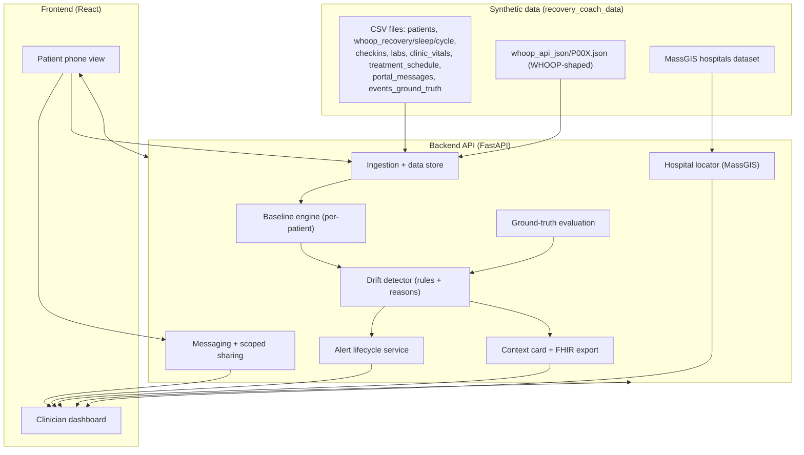
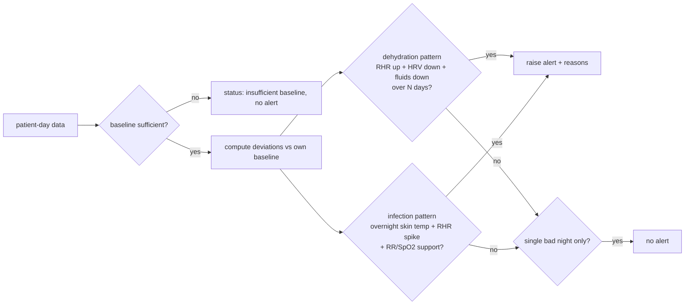
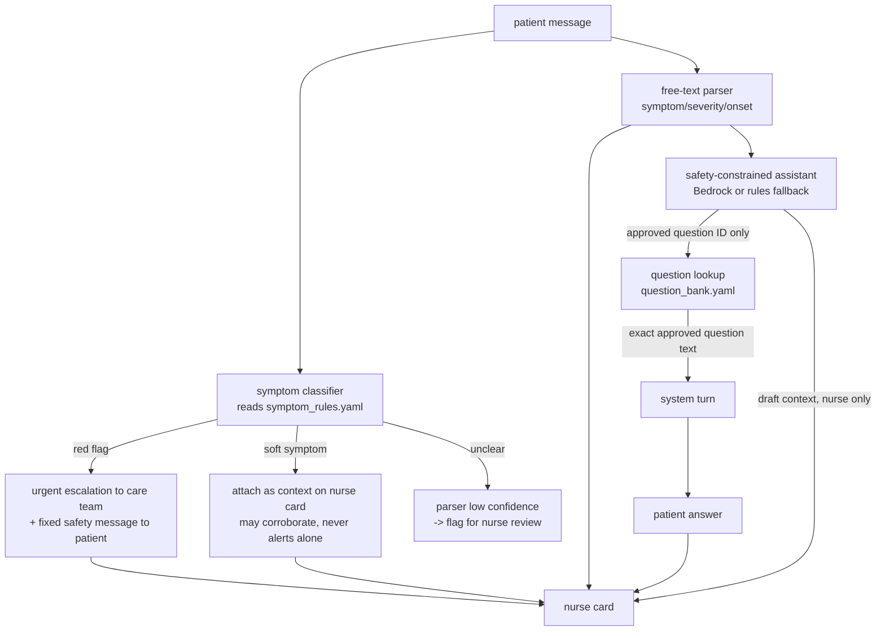

# Design — Between Visits

## Overview

Between Visits ingests a synthetic cohort of chemoradiation patients, computes each
patient's **personal pre-treatment baseline**, evaluates daily wearable + check-in data
against that baseline with a rules-based drift detector, and raises **explained** alerts
to a care-team nurse. The nurse works a **risk-ranked** patient list, opens a **CMS
care-update context card** (exportable as FHIR) per alert, gets a **nearest suitable
hospital** suggestion (MassGIS), and **tracks each alert to completion**. Patients use a
mobile phone view to check in, see plain-language status, and message the team with
**scoped data sharing**.

The design is deliberately simple and demo-oriented: a single backend API over the
synthetic dataset, a React frontend with two surfaces (patient / clinician), and a
rules-based detector whose thresholds are tuned against the bundled ground truth. The
physiology is simplified; the value is in the explained, loop-closing workflow — not in
a validated clinical model.

### Guiding constraints (from requirements)

- Decision support only; never a diagnosis; clinicians take every clinical action.
- Every alert carries its reasons, always visible.
- A single bad night can never alert on its own.
- Synthetic data only; every screen labeled "synthetic data."

## Architecture



### Technology choices

- **Backend:** Python + FastAPI. The synthetic data is Python/pandas-friendly, the
  bundled `generate.py` is Python, and FHIR tooling (`fhir.resources`) is mature in
  Python. Pandas handles baseline stats and rolling-window detection cleanly.
- **LLM assistant:** Provider-neutral Python wrapper with optional Amazon Bedrock via
  `boto3`; deterministic rules are the zero-configuration fallback. The model only
  selects approved question IDs and drafts nurse-facing context. It never generates
  patient-facing text, triages, scores risk, or overrides deterministic red flags.
- **Frontend:** Server-rendered HTML + CSS + vanilla JS served by the FastAPI backend,
  two surfaces (`/patient`, `/clinician`). Charts drawn as inline SVG from the
  baseline-vs-current series. (Originally specced as React + Vite; switched to
  server-rendered because the build/runtime environment has Python but no Node toolchain.
  The requirements only call for the two surfaces to exist and work, and a single Python
  service is simpler to deploy as one AWS container.)
- **Data store:** For the demo, load the synthetic CSV/JSON into an in-memory/SQLite
  store at startup; alerts, actions, and messages persist to SQLite so lifecycle state
  survives a reload. This keeps the deploy simple and reproducible.
- **Deploy (AWS):** Containerized backend on a single service, frontend served as static
  assets. See Deployment section. IaC or a scripted deploy makes it reproducible.

> Rationale: the task is a demo over a fixed synthetic cohort, not a high-scale
> production system. A single service + SQLite is the simplest thing that satisfies every
> requirement and is reproducible on AWS. If asked to scale later, the ingestion and
> store seams are where a managed DB would slot in.

## Data model

Backed by the bundled `recovery_coach_data` schema. Keyed on `patient_id` + `date`
(with `tx_day`, where `tx_day <= 0` is baseline, `tx_day == 1` is the first radiation
fraction).

### Core entities

- **Patient** — `patient_id, name, age, sex, diagnosis, stage, treatment, tx_start,
  device_start, baseline_weight_kg, cohort (demo|random), story, location(synthetic)`.
- **RecoveryDay** — `patient_id, date, tx_day, recovery_score, resting_heart_rate,
  hrv_rmssd_milli, spo2_percentage, skin_temp_celsius`.
- **SleepNight** — `patient_id, date, tx_day, sleep stage times (ms), disturbance_count,
  respiratory_rate, sleep_performance_percentage, sleep_efficiency_percentage`.
- **CycleDay** — `patient_id, date, tx_day, strain, kilojoule, average_heart_rate,
  max_heart_rate`.
- **CheckIn** — `patient_id, date, tx_day, pain_0_10, swallow_difficulty_0_10,
  nausea_0_10, fatigue_0_10, fluid_cups, meals_eaten_pct, transcript`.
- **Lab / ClinicVital / TreatmentDay** — supporting context (weekly labs, weekly vitals,
  radiation/cisplatin schedule) used for the context card and plausibility, not required
  for detection.
- **PortalMessage** — `patient_id, sent_at, tx_day, subject, body, true_triage,
  true_reason, helpful_wearable_context` (synthetic triage ground truth; seeds the chat
  threads for the demo patients).
- **ChatThread / ChatTurn** — a per-patient conversation. Each `ChatTurn` has
  `{id, thread_id, author (patient|nurse|system), kind (free_text|symptom_report|
  system_question|safety_message), text, question_id?, parsed_symptoms[], shared_signals[],
  created_at}`. System turns always reference an approved `question_id` or a fixed safety
  message id — never free text.
- **ParsedSymptom** — `{symptom, severity (0–10|null), onset|null, tier (soft|red_flag),
  confidence, needs_nurse_review: bool}`.
- **SymptomRulesConfig** (`config/symptom_rules.yaml`) — `red_flags[]` and
  `soft_symptoms[]` with match phrasing; the single clinician-reviewed source of truth.
- **QuestionBank** (`config/question_bank.yaml`) — the only text the system may ask;
  COSTaRS-style question ids with exact approved wording.
- **GroundTruthEvent** — `patient_id, event_type (dehydration|neutropenic_fever|
  false_alarm_confounder), onset_tx_day, earliest_reasonable_alert_tx_day,
  counterfactual_ed_tx_day, should_alert` — used only for evaluation, never shown as a
  cause of an alert.

### Derived entities

- **Baseline** — per patient, per signal: `{mean/median, sd/iqr, n_valid_days,
  sufficient: bool}` computed over `tx_day <= 0`. If `n_valid_days < min` (default 7),
  `sufficient = false` and no baseline-relative alerts fire.
- **SignalDeviation** — per patient-day-signal: `{value, baseline, delta, z, direction,
  missing}`.
- **Alert** — `{id, patient_id, type, severity, risk_score, created_at, status, reasons[],
  window, suggested_hospital?, actions[]}`.
- **Reason** — `{signal, current_value, baseline_value, deviation (z / delta), window,
  text}` — the human-readable "why."

## Components

### 1. Ingestion + data store

Loads CSVs (and the WHOOP-shaped JSON for demo patients) into the store on startup.
Normalizes to the entities above, parses `date`/`tx_day`, and marks missing days
(~4% off-wrist / skipped) as `missing` rather than imputing. Exposes read APIs the rest
of the backend uses. A loader flag can switch a demo patient's source between CSV and
WHOOP JSON to prove the swap-in story.

### 2. Baseline engine

For each patient, selects `tx_day <= 0` rows per signal, drops missing days, and computes
robust statistics (median + IQR by default; mean + sd available). Produces a `Baseline`
per signal with `sufficient` based on `n_valid_days`. All downstream comparisons are
baseline-relative (z-score or delta), never cross-patient.

### 3. Drift detector (rules + reasons)

A rules engine evaluated per patient-day over a rolling window. Two primary patterns,
both requiring **persistence or multi-signal corroboration** so no single night alerts:

**Dehydration pattern**
- Resting HR elevated vs baseline (e.g. z ≥ threshold) AND HRV depressed vs baseline,
  **sustained across N consecutive days** (default N = 3), AND
- Check-in `fluid_cups` trending down over the same window (and/or rising swallow/pain
  reducing intake).
- Mirrors P001's story: drift visible from ~tx day 17–19; the demo point is that an
  alert there prevents the natural-course ED visit on day 22.

**Infection / possible neutropenic fever pattern**
- Overnight `skin_temp_celsius` spike vs baseline AND resting HR spike vs baseline on the
  same morning sync, with supporting rise in `respiratory_rate` and/or drop in
  `spo2_percentage`.
- This pattern is sharp and can fire on a **single overnight** because it is corroborated
  across **multiple independent signals** simultaneously — distinct from a single-signal
  single-night blip, which is explicitly disallowed. Mirrors P002: skin temp +1.6 °C,
  RHR +20 overnight tx day 33–34, detectable on morning sync before the patient calls.

**False-alarm suppression**
- A lone low recovery score or one restless night (the `false_alarm_confounder`:
  P003 day 10, P102) fails both patterns because neither persistence (dehydration) nor
  multi-signal overnight corroboration (infection) is met. This is enforced in the rules
  and verified against ground truth.

**Output:** when a pattern fires, the detector emits an `Alert` with a `reasons[]` list
(each reason naming signal, current value, baseline, deviation, and window) and a
`risk_score` (weighted combination of deviation magnitude, number of corroborating
signals, pattern severity, and days persisted) used to rank the dashboard.



### 4. Alert lifecycle service

Owns alert state: `open → acknowledged → in_progress → resolved`, plus `dismissed` for
false alarms. Records each action (`actor`, `timestamp`, `action`, `note`). Resolved and
dismissed alerts leave the active risk ranking but keep full history for audit. Alerts
open past a configurable SLA are flagged `overdue`. No transition happens automatically —
a clinician drives every change.

### 5. Context card + FHIR export

Assembles the **CMS care-update** fields per alert: patient identity/demographics,
current status/reason for the update, relevant observations (driving wearable signals and
check-in values with baselines), the recommendation **framed as decision support**, and
timing. Renders as the dashboard context card and exports a **FHIR `Bundle`**
(`Patient` + `Observation` per driving signal + a `Communication`/`CarePlan`-style
summary). The bundle carries a tag marking it synthetic / decision-support, not a
diagnosis.

### 6. Hospital locator (MassGIS)

Loads the MassGIS hospitals dataset, and for an escalation computes the nearest suitable
hospital to the patient's synthetic location (haversine distance; "suitable" filters to
acute-care/ED-capable facilities). Returns name, address, distance, and the reason it was
chosen, framed as a suggestion the clinician confirms. Returns an explicit "none within
range" when appropriate.

### 7. Care-team chat (conversation, symptom reporting, scoped sharing)

A persistent **conversation thread** per patient between the patient and the care team.
The thread carries three turn types: **patient** turns (free text and/or structured
symptom reports), **nurse** turns (human follow-ups), and **system** turns — which are
strictly limited to the approved question bank and the fixed safety messages. The system
never generates interpretive or advisory text. The chat extends (and replaces) the former
one-shot messaging feature; scoped data sharing still applies per message.

The chat is composed of several small, independently testable pieces:

**7a. Symptom classifier (two tiers, config-driven).**
Every inbound patient message is classified against a **single clinician-reviewed config
file**, `config/symptom_rules.yaml`, holding two lists:
- `red_flags` — fever; chills or shaking; unable to keep fluids down for 24 h; fainting
  or confusion; trouble breathing; chest pain; bleeding; unable to swallow saliva. Each
  entry carries the trigger phrasing/synonyms it matches.
- `soft_symptoms` — tired, mild nausea, sore throat, a little dizzy, etc.

No red-flag or soft-symptom term is hardcoded anywhere else; all code reads this file.
A red-flag match is an **immediate urgent escalation** (see 7b). A soft-symptom match is
attached as **context only** and can corroborate a wearable/check-in pattern but never
alerts on its own (same principle as the single-bad-night rule in the detector).

**Negation is applied to soft symptoms only, never to red flags.** Negation parsing
(e.g. "no fever") is inherently fragile, and suppressing a red flag is the dangerous
direction — a missed red flag is far worse than an occasional extra escalation that a
clinician reviews anyway. So the classifier is "fail safe, not silent": a red-flag phrase
always escalates regardless of surrounding words, while negation only refines the
soft-symptom context shown on the card. (This decision was driven by a property test that
found "no fever" was being wrongly suppressed.)

**7b. Red-flag escalation (notification-only safety override).**
When a message matches a red flag, the system:
1. Creates an `urgent` escalation item for the care team immediately, **regardless of
   wearable state**.
2. Returns to the patient a **fixed safety message** verbatim: "Contact your care team
   now. If this is an emergency, call 911." — no interpretation, triage, or diagnosis.
This override only *notifies*; it makes no clinical decision and resolves nothing, which
keeps it consistent with the "clinicians decide / no auto clinical action" guardrail.

**7c. Free-text symptom parser.**
Extracts structured fields (`symptom`, `severity` 0–10 if stated, `onset`) from the
message for the nurse card. Parsing is conservative: if confidence is below a threshold,
the message is **flagged for nurse review** rather than populating a guessed value. The
parser output is nurse-facing context, not a trigger.

**7d. Scripted follow-up engine (question bank).**
When information the nurse would otherwise chase is missing, the system asks a follow-up
drawn **only** from a fixed question bank in `config/question_bank.yaml`, modeled on
published oncology symptom-triage protocols (COSTaRS-style: onset, severity 0–10, fluid
intake, temperature if known). The engine selects a question id and renders its exact
approved text; it records the patient's answer and attaches it to the alert/nurse card.
It **never scores, triages, or advises**. A guard asserts every system turn's text equals
an approved question-bank entry or a fixed safety message (enforced by a property test).

**7e. Scoped data sharing.**
As before: for a message the system suggests the relevant wearable signals/time window
(optionally pre-selected from `helpful_wearable_context`), the patient **approves exactly
what is shared** (including "no data needed"), and the nurse sees only approved data with
a clear shared-vs-withheld indication.

**7f. Expectations banner.**
The chat always shows a persistent notice that it is not monitored 24/7, with the
after-hours contact number.

**7g. Safety-constrained LLM orchestration.**
`ClinicalAssistant` provides a provider-neutral wrapper with an optional Amazon Bedrock
implementation (configured by `BETWEEN_VISITS_LLM_PROVIDER=bedrock`,
`BEDROCK_MODEL_ID`, and the normal AWS region/credential chain). Kiro remains the
build environment; Bedrock is the runtime model provider for the AWS demo.

The wrapper is deliberately narrower than a chatbot:
1. The deterministic red-flag classifier runs first. A red flag bypasses the model, so
   an LLM can never suppress or delay urgent escalation.
2. For non-red-flag messages, the model receives the message as explicitly untrusted
   data plus the approved question list. It returns JSON only: `question_id | null` and
   a nurse-facing summary of at most 60 words.
3. The server schema-validates the result. Only an ID present in
   `config/question_bank.yaml` is accepted; patient-facing text is then looked up from
   that local file. **Raw model text is never shown to the patient.**
4. The summary appears only on the nurse card as "AI-assisted context draft — verify."
   It cannot affect risk score, alert type, or lifecycle state.
5. If Bedrock is not configured, times out, errors, or returns malformed/unapproved
   output, deterministic rules select the next approved question. Messaging continues.

This gives the demo an intelligent response loop while preserving the property that every
patient-facing system turn is byte-identical to clinician-approved content.



#### Chat configuration (clinician-reviewed, authoritative content)

These are the complete contents of the three config sources — the **single source of
truth** reviewed by a clinician. No term or wording below is duplicated in code. Matching
is case-insensitive against the message text; `match` phrases are substrings/synonyms,
and `negations` guard against false matches (e.g. "no chest pain"). This content is
simplified for a synthetic demo and is **not** a validated triage instrument.

**`config/symptom_rules.yaml` — two tiers**

```yaml
version: 1
reviewed_by: "<clinician name / date — fill at review>"
red_flags:              # any match -> immediate urgent escalation (notification-only)
  - id: rf_fever
    label: "Fever"
    match: ["fever", "temperature over 100.4", "temp 101", "burning up", "very hot"]
  - id: rf_chills_rigors
    label: "Chills or shaking"
    match: ["chills", "shaking", "shivering", "rigors", "teeth chattering"]
  - id: rf_no_fluids_24h
    label: "Unable to keep fluids down for 24 hours"
    match: ["can't keep fluids", "cannot keep water down", "vomiting everything",
            "throwing up everything", "nothing stays down", "no fluids for a day"]
  - id: rf_fainting_confusion
    label: "Fainting or confusion"
    match: ["fainted", "passed out", "blacked out", "confused", "disoriented",
            "not making sense"]
  - id: rf_trouble_breathing
    label: "Trouble breathing"
    match: ["trouble breathing", "can't breathe", "short of breath",
            "hard to breathe", "gasping"]
  - id: rf_chest_pain
    label: "Chest pain"
    match: ["chest pain", "chest pressure", "chest tightness", "pain in my chest"]
  - id: rf_bleeding
    label: "Bleeding"
    match: ["bleeding", "coughing up blood", "blood in", "vomiting blood",
            "nose won't stop bleeding"]
  - id: rf_cant_swallow_saliva
    label: "Unable to swallow saliva"
    match: ["can't swallow my spit", "cannot swallow saliva",
            "drooling can't swallow", "can't swallow at all"]

soft_symptoms:          # context only -> never alerts on its own, may corroborate
  - id: ss_tired
    label: "Tired / fatigue"
    match: ["tired", "fatigue", "worn out", "no energy", "exhausted"]
  - id: ss_mild_nausea
    label: "Mild nausea"
    match: ["a little nauseous", "mild nausea", "queasy", "slightly sick to my stomach"]
  - id: ss_sore_throat
    label: "Sore throat"
    match: ["sore throat", "throat hurts", "scratchy throat", "throat is raw"]
  - id: ss_mild_dizzy
    label: "A little dizzy"
    match: ["a little dizzy", "slightly lightheaded", "bit woozy", "mildly dizzy"]
  - id: ss_mouth_sores
    label: "Mouth sores / mucositis discomfort"
    match: ["mouth sores", "sores in my mouth", "mouth is sore", "ulcers in my mouth"]
  - id: ss_poor_appetite
    label: "Poor appetite"
    match: ["not hungry", "no appetite", "can't eat much", "don't feel like eating"]

negations: ["no ", "not ", "without ", "don't have ", "denies ", "didn't "]
```

> Overlap rule: terms like "dizzy"/"nausea" are soft, but "fainting/confusion" and
> "can't keep fluids down" are red-flag. The classifier checks red-flag matches **first**;
> any red-flag hit wins regardless of soft matches in the same message.

**`config/question_bank.yaml` — the only text the system may ask (COSTaRS-style)**

```yaml
version: 1
reviewed_by: "<clinician name / date — fill at review>"
# The system may ONLY render one of these exact strings as a follow-up turn.
# It records the answer verbatim and attaches it to the nurse card.
# It NEVER scores, triages, interprets, or advises.
questions:
  - id: q_onset
    text: "When did this start? (for example: today, yesterday, a few days ago)"
    answer_type: text
  - id: q_severity
    text: "On a scale of 0 to 10, how bad is it right now, where 0 is none and 10 is the worst you can imagine?"
    answer_type: integer_0_10
  - id: q_trend
    text: "Is it getting better, staying the same, or getting worse?"
    answer_type: choice
    choices: ["better", "same", "worse"]
  - id: q_fluids_today
    text: "About how many cups of fluid have you had today?"
    answer_type: number
  - id: q_fluids_keeping_down
    text: "Are you able to keep fluids down?"
    answer_type: choice
    choices: ["yes", "no", "not sure"]
  - id: q_temperature
    text: "If you have a thermometer, what is your temperature? (leave blank if you don't have one)"
    answer_type: text
  - id: q_eating
    text: "About what fraction of your meals have you been able to eat today?"
    answer_type: text
  - id: q_swallowing
    text: "How difficult is swallowing right now, from 0 to 10?"
    answer_type: integer_0_10
  - id: q_meds_taken
    text: "Have you been able to take your prescribed medications today?"
    answer_type: choice
    choices: ["yes", "no", "partly"]
```

**`config/safety_messages.yaml` — the only non-question text the system may emit**

```yaml
version: 1
reviewed_by: "<clinician name / date — fill at review>"
safety_messages:
  - id: sm_red_flag            # shown verbatim on any red-flag detection; no interpretation
    text: "Contact your care team now. If this is an emergency, call 911."
  - id: sm_expectations_banner # persistent banner on the chat, not a per-message turn
    text: "This chat is not monitored 24/7. For anything urgent after hours, call <AFTER_HOURS_NUMBER>. If this is an emergency, call 911."
  - id: sm_received            # optional neutral acknowledgement; no triage
    text: "Thanks — your message has been sent to your care team."
```

The property-based safety test (see Testing strategy) asserts that every system turn the
chat can emit is byte-identical to one of the `questions[].text` or
`safety_messages[].text` values above — nothing else is ever generated.

### 8. Ground-truth evaluation

An offline/endpoint routine runs the detector across the whole cohort and compares to
`events_ground_truth.csv`: for each `should_alert = True` event, did an alert fire within
`[onset_tx_day, earliest_reasonable_alert_tx_day]`? For each `should_alert = False`
(false-alarm) case, did we correctly **not** alert? Reports timeliness and false-alarm
rate — the demo's credibility metric.

## Frontend surfaces

### Patient phone view (`/patient`)
Mobile-first. Daily check-in form (pain, swallow, nausea, fatigue, fluid cups, meals %),
a plain-language, non-diagnostic status ("You're tracking okay" / "Your team is reviewing
your recent readings"), and the **care-team chat**: a conversation thread where the
patient can report symptoms any time, answer scripted follow-ups, and approve scoped data
sharing per message. The chat shows the persistent **expectations banner** (not monitored
24/7 + after-hours number); red-flag messages return the fixed safety message. No risk
score or diagnosis shown to the patient. "Synthetic data" label always visible.

### Clinician dashboard (`/clinician`)
Risk-ranked cohort list (open/high-risk at top; non-alerting patients show status
without implying risk). Selecting an alerting patient opens the context card: CMS fields,
baseline-vs-current trend plots of the driving signals, the always-visible reason list,
the nearest-hospital suggestion, lifecycle controls (acknowledge / in-progress / resolve
/ dismiss with note), and a FHIR export button. The card also shows **chat-derived
context**: parsed patient-reported symptoms (with their tier), follow-up answers, any
red-flag urgent escalations, and messages flagged for nurse review. Overdue alerts
flagged. "Synthetic data" label always visible.

## API (representative)

- `GET /patients` — cohort with current status + risk rank.
- `GET /patients/{id}` — detail incl. baseline sufficiency and recent signals.
- `GET /patients/{id}/timeseries?signals=...` — baseline-vs-current series for plots.
- `POST /patients/{id}/checkins` — submit a daily check-in.
- `GET /alerts?status=open` — risk-ranked active alerts.
- `GET /alerts/{id}` — alert with reasons + context card payload.
- `POST /alerts/{id}/actions` — advance lifecycle (acknowledge/in_progress/resolve/dismiss).
- `GET /alerts/{id}/fhir` — FHIR Bundle export.
- `GET /alerts/{id}/hospital` — nearest suitable hospital suggestion.
- `GET /patients/{id}/chat` — the conversation thread (all turns).
- `POST /patients/{id}/chat` — patient sends a turn with `sharedSignals[]` scope;
  response includes classification outcome (soft/red-flag/needs-review), any fixed safety
  message, and parsed symptoms.
- `POST /patients/{id}/chat/followup` — system asks the next approved question-bank item
  (returns a `question_id` and its exact text); patient answer posted back as a turn.
- `GET /patients/{id}/chat/context` — chat-derived context for the nurse card.
- `GET /config/question-bank` / `GET /config/symptom-rules` — expose the approved config
  (read-only) so the UI and tests can assert against the single source of truth.
- `GET /eval/ground-truth` — detector-vs-ground-truth timeliness + false-alarm report.

## Error handling

- **Insufficient baseline:** show "insufficient baseline" status; suppress
  baseline-relative alerts rather than guessing.
- **Missing days:** treat as missing per signal; never impute; never let a gap trigger an
  alert.
- **Hospital not found:** return explicit "none within range," not a misleading nearest.
- **FHIR export failure:** surface a clear error and keep the on-screen card usable.
- **Data load failure at startup:** fail fast with a clear message naming the missing
  file so the demo deploy is debuggable.

## Testing strategy

- **Baseline engine unit tests:** correct stats, `sufficient` threshold, exclusion of
  missing days.
- **Detector unit tests:** dehydration pattern fires only with persistence + falling
  fluids; infection pattern fires on corroborated overnight spike; **single-night blip
  never alerts** (explicit test against the false-alarm confounder).
- **Ground-truth evaluation test:** across the cohort, true events alert within
  `[onset, earliest_reasonable]`; `should_alert = False` cases do not alert. This is the
  primary correctness gate.
- **FHIR validation test:** exported bundle validates and carries the synthetic /
  decision-support tag.
- **Hospital locator test:** nearest suitable result and the "none within range" path.
- **Chat scope test:** only approved signals reach the nurse; "no data needed" path
  works.
- **Chat parser test:** structured extraction (symptom/severity/onset); low-confidence
  messages flag for nurse review instead of guessing.
- **Property-based chat-safety tests** (the critical safety gate — use a generator such
  as Hypothesis over messages seeded with the config terms plus random filler):
  1. **Red-flag always escalates** — for any message containing any red-flag term from
     `symptom_rules.yaml` (any casing/surrounding text, any wearable state), the outcome
     is an urgent escalation and the patient sees the exact fixed safety message.
  2. **Soft symptom never alerts alone** — for any message containing only soft-symptom
     terms and no red flag, no alert/escalation is produced; it only attaches as context.
  3. **System never speaks off-script** — for any sequence of system turns the engine can
     produce, every system turn's text is identical to an entry in `question_bank.yaml`
     or the fixed safety-message set; nothing else is ever emitted.
- **Config-source test:** red-flag/soft terms resolve only from the config file; a change
  to the file changes behavior with no code edits (no hardcoded duplicates).
- **Frontend smoke:** patient check-in round-trips; dashboard renders ranked list, a
  context card with visible reasons, and a "synthetic data" label on every screen.

## Deployment (AWS)

- Containerize the FastAPI backend (serving the API and the built static frontend, or a
  static-site + API split).
- Simplest reproducible target: a single container service (e.g. **AWS App Runner** or
  **ECS Fargate**) fronting the API, with the SQLite file baked/mounted for the demo;
  frontend static assets on **S3 + CloudFront** or served by the same container.
- Make it reproducible via IaC (CDK/CloudFormation/Terraform) or a documented, scripted
  deploy.
- The deployed demo exposes both `/patient` and `/clinician` at a public URL, serves the
  synthetic cohort, and preserves the "synthetic data" labeling.

> Note: production use would require a managed database, auth/PHI controls, and clinical
> validation. This deployment is a synthetic-data demo and is scoped as such.

## SMART on FHIR and production EMR integration

### Hackathon implementation

The clinician application supports a SMART App Launch EHR flow at `/smart/launch` and
`/smart/callback`. It performs SMART discovery, authorization-code exchange with PKCE,
keeps the access token server-side, and stores only an opaque session id in an HttpOnly
SameSite cookie. The launch can be exercised with the [SMART Health IT
launcher](https://launch.smarthealthit.org/) using the values shown at `/smart/setup`.
The public launcher advertises R4 EHR launch, PKCE, patient context, and OAuth endpoints
through its SMART configuration.

The alert card reads synthetic FHIR R4 `Observation` resources from
`https://hapi.fhir.org/baseR4`, requesting `category=laboratory` and selecting by these
exact LOINC codes: sodium `2951-2`, potassium `2823-3`, creatinine `2160-0`, BUN
`3094-0`, magnesium `19123-9`, WBC `6690-2`, ANC `751-8`, hemoglobin `718-7`, platelets
`777-3`, and albumin `1751-7`. Each displayed row includes the latest value at or before
the alert's simulated date, collection date, reference range, interpretation flag, and
change from the previous result. The card warns when the newest panel is more than five
days old.

`scripts/seed_hapi_fhir.py` idempotently loads 23 tagged synthetic patients and 1,840
routine laboratory Observations. Counterfactual natural-course ED rows are excluded.
Because the [public HAPI R4 server](https://hapi.fhir.org/baseR4) is a shared test/demo
service that can be reset, an equivalent bundled-FHIR fallback keeps the demo usable.
Every view and resource remains labeled synthetic.

The nurse handoff downloads as a standalone FHIR R4 `Communication`. It includes alert
reasoning, latest mapped labs, freshness state, synthetic/decision-support tags, and an
explicit clinician-verification requirement. Write-back is not performed in the demo.

### Production integration note

1. **SMART EHR launch:** Register a confidential SMART client with each health system,
   use exact HTTPS redirect URIs, least-privilege v2 scopes, issuer-specific allowlists,
   encrypted shared token storage, refresh-token rotation, audit logging, and explicit
   mapping between EHR patient identity and the Between Visits enrollment record.
2. **CDS Hooks `patient-view`:** A production CDS service can respond to the
   `patient-view` hook with a concise, non-diagnostic card containing current risk,
   reasons, data freshness, and a SMART deep link to the full context card. The hook card
   should not autonomously order care or expose unsupported diagnosis claims.
3. **Bulk FHIR nightly refresh:** Use authorized system-to-system Bulk Data `$export`
   for a nightly cohort refresh, then incremental patient-level reads for recent results.
   Preserve source timestamps, provenance, deletion handling, and per-resource access
   controls. UI freshness derives from source collection time, not ingestion time.
4. **Write-back, subject to health-system approval:** Keep writes disabled by default.
   After governance, clinical-safety, security, and workflow approval, the handoff may be
   written as a `Communication` and/or a health-system-approved `Task` pattern. The
   health system controls destination, status semantics, authorship, retention, and audit.
   No write-back should occur merely because the detector raised an alert.
5. **Environment separation:** Replace public HAPI and SMART launcher endpoints with the
   health system's R4 base URL and authorization server. Never send PHI to shared public
   test servers; this project uploads synthetic records only.

Content was rephrased for compliance with licensing restrictions. Implementation details
follow the SMART Health IT tutorial/discovery behavior and the public HAPI R4 capability
statement linked above.

### Free hackathon deployment profile

The repository includes a Render Blueprint (`render.yaml`) for a Free Python web service.
It installs `requirements.txt`, starts FastAPI with Uvicorn on Render's assigned `$PORT`,
uses the no-cost deterministic chat assistant, and reads synthetic labs from public HAPI
with the bundled fallback.

Render Free web services sleep after 15 minutes without inbound traffic and use an
ephemeral filesystem. Therefore SQLite chat turns and alert-lifecycle actions reset on
restart/spin-down; the fixed cohort and detector alerts reseed at startup. This is
acceptable for the hackathon but not production. Production requires durable encrypted
storage, authentication, authorization, audit, and health-system-managed FHIR endpoints.
See [Render Free service limitations](https://render.com/docs/free) and the
[Render FastAPI guide](https://render.com/docs/deploy-fastapi).

Content was rephrased for compliance with licensing restrictions.
