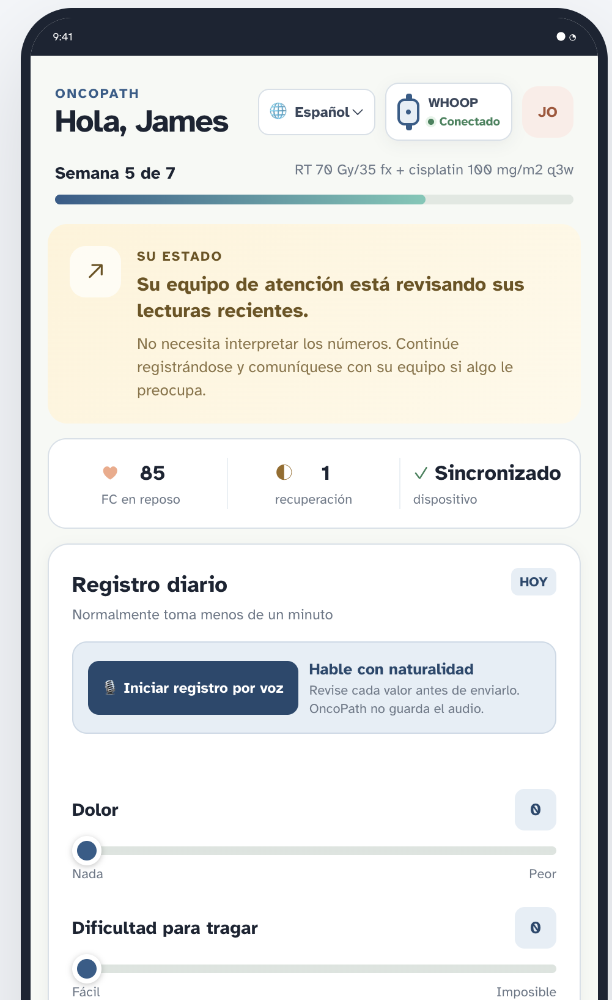

# OncoPath

**Catch the drift between visits.** OncoPath turns everyday wearable signals, a one-minute daily check-in and routine labs into an explained care-team alert, then tracks that alert until care is complete.

**Live demo:** https://between-visits-hr9m.vercel.app · care team: [`/clinician`](https://between-visits-hr9m.vercel.app/clinician) · patient: [`/patient/P001`](https://between-visits-hr9m.vercel.app/patient/P001)

**Track:** Healthcare & Biotech, H1: Turning wearable data into better healthcare

> **All data is synthetic. No real patients.** OncoPath is decision support for a care team. It never diagnoses, and every clinical decision stays with qualified clinicians.

---

## Judge navigation

- **[Open the live care-team dashboard](https://between-visits-hr9m.vercel.app/clinician)** or **[try the Spanish patient app](https://between-visits-hr9m.vercel.app/patient/P001)**
- [The problem](#the-problem)
- [Who benefits and the business case](#who-benefits-and-how-it-pays-for-itself)
- [What OncoPath does](#what-oncopath-does)
  - [72-hour prediction layer](#prediction-layer-72-hour-outlook)
  - [Three demo stories](#the-three-demo-stories)
- [Accessibility, Spanish and voice](#accessibility-and-equity)
  - [Spanish patient-app screenshot](#spanish-patient-experience)
- [Public data and standards](#public-data-and-standards-used)
- [How we built it with Kiro](#how-we-built-it-with-kiro)
  - [Kiro features: Specs, Agent Focus, Workflows and Kiro Crew](#kiro-features-we-used)
- [Safety design](#safety-design)
- [Limitations](#limitations)
- [Run OncoPath locally](#run-the-oncopath-demo)
- [SMART on FHIR integration](#smart-on-fhir-and-synthetic-laboratory-data)
- [Synthetic data](#synthetic-data)
- [Sources](#sources)

---

## The problem

Patients on cancer treatment get sick at home, between weekly visits, and the warning signs show up days before the ER.

- **1 in 3** adults starting chemotherapy had an unplanned hospital presentation in the first three cycles; **52%** of those presentations did not need admission. Fever (35%) and nausea/vomiting (21%) were the top reasons. *(Secondary analysis of an RCT, 346 patients, two Australian tertiary hospitals.)*
- **63%** of ED visits during cancer treatment carried a potentially preventable diagnosis, and those visits made up **73%** of ED spending *(Panattoni et al., Fred Hutchinson Cancer Center, ASCO Quality Care Symposium 2017)*.
- In head and neck cancer, it is worse: in one cancer center's series, **52%** of patients on concurrent chemoradiation had an unplanned admission, at a **median $69,460 per stay**. Dehydration and infection were the leading causes *(single-center retrospective review, 2007–2011)*.

Care teams see these patients about once a week. Labs are drawn weekly. Between visits, nobody is watching.

## Who benefits and how it pays for itself

| Who | What they get |
|---|---|
| **Patients** (especially rural) | Problems caught at home, care routed to the nearest capable hospital instead of the ER, control over exactly what data is shared |
| **Oncology nurses** | A short, risk-ranked queue with reasons, instead of chasing 20+ charts and phone calls |
| **Cancer centers / health systems** | Fewer avoidable ED visits and admissions, which CMS publicly reports after outpatient chemotherapy (measure OP-35) and value-based oncology models reward |

**Revenue path that exists today.** Medicare already reimburses remote patient monitoring. 2026 national average rates: about **$22** device setup (99453), **$47–52/month** device supply and data (99454 / 99445), **$52** for the first 20 minutes of clinician management per month (99457). A 7-week treatment course is roughly **$200–250 per patient** in billable monitoring.

**Return on one avoided admission.** One avoided head and neck admission (~$69k in the study above) covers monitoring for roughly 300 patients.

### Market size (estimates, math shown)

| Segment | Patients / year (US) | Value at ~$200–400 per treatment course |
|---|---|---|
| **Beachhead:** head and neck cancer | ~70,000 new cases (approximate, American Cancer Society) | ~$14–28M |
| **Expansion:** all patients treated in outpatient oncology clinics | >1,000,000 (CDC) | ~$200–400M |
| **Beyond oncology:** heart failure, COPD, pneumonia readmissions | CMS already tracks excess readmissions for every Massachusetts hospital (Hackachusetts kit) | Same engine, new condition profiles |

These are order-of-magnitude estimates from reimbursement rates, not a forecast. The bigger value is avoided admissions, which accrue to the health system.

## What OncoPath does

1. **Learn normal.** Two weeks of the patient's own pre-treatment wearable baseline (resting heart rate, HRV, skin temperature, sleep, strain).
2. **Watch between visits.** A one-minute daily check-in (pain, swallowing, nausea, fluids, meals) plus overnight wearable sync.
3. **Explain drift.** Alerts fire only when signals persist or corroborate (e.g. resting HR up and HRV down for several days while fluid intake falls). Every alert lists its reasons against the patient's own baseline. A single bad night never alerts on its own.
4. **Equip the nurse.** A queue ranked by the 72-hour outlook (below) and a context card following the CMS care-update fields, with the latest labs pulled over **SMART on FHIR** (LOINC-coded Observations, collection date, trend, and a freshness warning when labs are stale), exportable as FHIR R4.
5. **Two-way chat with guardrails.** Patients report symptoms in their own words and choose exactly which wearable signals to share, for which time window, per message. Red-flag symptoms (fever, chills, fainting, can't keep fluids down, chest pain…) always escalate immediately with a fixed safety message. Follow-up questions come only from an approved question bank.
6. **Close the loop.** Suggest the nearest emergency-capable hospital, then track the alert from acknowledged to resolved.

### Prediction layer: 72-hour outlook

On top of alerting, OncoPath forecasts which patients are most likely to deteriorate in the **next 72 hours** and uses that to rank the nurse's queue.

- **Inputs:** the last 3 days of resting heart rate, HRV and skin temperature as z-scores against the patient's own pre-treatment baseline, plus the drop in daily fluid intake from check-ins.
- **Two pattern scores:** a dehydration score (heart rate up, HRV down, fluids down) and an infection score (heart rate up, skin temperature up). The higher one sets the pattern and a 0–100 outlook score (low / moderate / elevated).
- **Direction:** worsening, stable or improving, from how resting heart rate moved across those 3 days.
- **Drivers:** the top three reasons in plain language (e.g. "Resting heart rate is +5.3 SD from baseline"), shown on the card so the nurse can see why.
- **Overrides:** a patient-reported red flag always goes to the top as urgent, whatever the forecast says.

It is a transparent, rule-based prototype ranking signal, not a calibrated clinical probability. Calibrating it on real, consented outcome data is the first validation step.

### The three demo stories

| Patient | What happens | What to look for |
|---|---|---|
| **Maria** (P001), HPV+ oropharynx, weekly cisplatin, rural Franklin County | Mouth sores and nausea, so she drinks less | Wearable and check-in drift flag dehydration around treatment day 18–19; her day-15 labs are still normal; the natural-course ER visit would have been day 22 |
| **James** (P002), larynx, cisplatin every 3 weeks | Neutrophils fall after cycle 2 | Overnight skin temperature and heart rate jump; flagged on the morning sync, before he messages at 6:15 am |
| **Linda** (P003), oral cavity, radiation only | One late night at a family wedding | **Nothing fires.** The control case for alarm fatigue |

## Accessibility and equity

- **Built for distance.** Synthetic patients are placed in real Massachusetts towns with drive time to the treating center (Maria: ~50 miles, ~78 minutes). Routing suggests the nearest capable hospital, or says explicitly when none is within range.
- **English and Spanish.** Language selector for the check-in, patient interface and fixed safety messages; Spanish red-flag terms are matched from clinician-reviewable config.
- **Voice or typing.** Optional browser dictation for check-ins and messages. Voice fills the form but never submits it; the patient reviews first. No audio is stored. Typed entry is always available.
- **Consent by design.** Nothing is shared unless the patient selects it, per message, and the selection resets afterwards.
- **Low burden.** One-minute check-in with sliders and plain language, works on any phone browser.

### Spanish patient experience

The same check-in can be completed in Spanish by touch or voice. Voice fills the form
without submitting it, so the patient can review every value first. The larger type and
touch targets are designed for older adults receiving cancer treatment.

<p align="center">
  
</p>

<p align="center"><em>Spanish patient view with WHOOP connection, translated status, larger controls and reviewed voice entry.</em></p>

## Public data and standards used

| Resource | How OncoPath uses it |
|---|---|
| MassGIS hospitals layer (Hackachusetts kit) | Hospital locator; the app ships an 18-hospital acute-care subset with approximate coordinates |
| HL7 FHIR R4 + SMART App Launch | EHR launch (tested with the SMART Health IT launcher), lab Observations by LOINC code, handoff as a FHIR `Communication` |
| HAPI FHIR public test server | Hosts 1,840 synthetic lab Observations for 23 patients (re-seedable; bundled fallback if unavailable) |
| CMS care-update template fields | Structure of the nurse context card |
| CMS OP-35 / hospital readmissions (kit) | Why health systems care; expansion beyond oncology |
| Consumer wearable developer API schema | Synthetic wearable fields use the same names (recovery, sleep, cycle) so real, consented data can be swapped in |
| Published evidence | Step counts during chemoradiation predicted hospitalization, AUC 0.85 (Friesner et al., *JAMA Oncology* 2024); in head and neck radiotherapy, steps alone did not predict admission (Sher et al., *JCO CCI* 2022). That is why OncoPath combines wearables with check-ins and labs |

## How we built it with Kiro

**Spec-driven from the start.** One Kiro spec (`.kiro/specs/between-visits/`) holds **13 requirements** (personal baseline, ingestion, drift detection with reasons, clinician dashboard, CMS/FHIR card, hospital routing, alert lifecycle, chat with scoped sharing, patient view, synthetic cohort, safety guardrails, deployment, SMART on FHIR), a design document with correctness properties, and **25 implementation tasks, all completed**. Clinical safety rules were written as requirements first, so Kiro implemented them as testable behavior instead of UI copy.

**Property-based testing for clinical safety** (Hypothesis). Properties include:

- a red-flag message **always** escalates, in English or Spanish
- a soft symptom alone **never** escalates
- the system **never** sends text outside the approved question bank and safety messages
- an unknown question ID can never produce a patient-facing turn, even from the optional Bedrock model
- per-message wearable consent persists exactly the selected signals and window
- every lab shown is the most recent Observation for its LOINC code

**What PBT caught that unit tests missed:** the generator found that a message containing "no fever" was being suppressed by negation handling. Suppressing a red flag is the dangerous direction, so we changed the design: negation now refines soft-symptom context only, and red-flag phrases always escalate ("fail safe, not silent").

### Kiro features we used

| Kiro feature | How it helped OncoPath |
|---|---|
| **Specs** | Requirements, design and implementation tasks stayed together in `.kiro/specs/between-visits/`, so clinical guardrails were defined before code and remained traceable through implementation. |
| **Agent Focus** | We gave each agent one bounded objective, exact files and explicit checks, such as implementing the detector, connecting SMART/FHIR, aligning Maria's timeline or refining the patient interface. This reduced unrelated edits and made results easier to review. |
| **Workflows** | Repeatable agent workflows handled multi-step changes that needed investigation, implementation and verification. For example, one workflow changed Maria's treatment date, regenerated both synthetic datasets, proved that non-P001 records did not move and ran the full test suite. |
| **Kiro Crew** | We used Kiro Crew to coordinate specialized agents across the backend, synthetic clinical data, patient and clinician experiences, safety review and deployment work. Each agent worked from the shared spec while the main session handled decisions and integration. |
| **Multiple environments (experimental)** | Isolated environments kept longer or riskier agent work separate from the main workspace until its output was ready to review. |
| **Editor and terminal context** | Kiro worked directly with active files, Git diffs, diagnostics, generated datasets and test output, which kept design decisions connected to the implementation evidence. |

The human stayed in the loop for scope and product decisions: which clinical indicators to show, how many patients to prioritize, the OncoPath rebrand, Spanish and voice support, and every commit and push to `main`.

**Research inside Kiro.** Kiro looked up LOINC codes, FHIR resource shapes, SMART launch details, oncology symptom-triage practice and deployment docs, so clinical details in the code came with sources.

**Where Kiro struggled, and what we did.** Deployment was the hardest part: the first target (Render with deploy hooks) failed across several attempts, so we switched to Vercel's Git integration. Research and long runs were slow compared with other agentic tools we've used; auto-approve still paused for approvals; agents sometimes drifted from instructions; and cancelling a run did not always stop it. Small spec tasks and running risky work in a separate environment helped.

**Kiro for development, Bedrock at runtime.** The app runs on deterministic rules by default. Optional Amazon Bedrock can select a follow-up question **ID** only; the server renders the approved text, and red-flag escalation runs before and independently of the model.

## Safety design

- Decision support only: no diagnosis, no triage advice in the chat.
- Red flags always escalate; soft symptoms never alert alone; single bad nights never alert alone.
- Every alert shows its reasons against the patient's own baseline.
- Patient-facing system text comes only from `config/question_bank.yaml` and `config/safety_messages.yaml`.
- Red-flag and symptom rules live in one clinician-reviewable file (`config/symptom_rules.yaml`).
- Synthetic data only, in the app, on HAPI and in the SMART sandbox.

## Limitations

- All patients, wearable data and labs are synthetic; the physiology is simplified and not a validated simulation. Detector performance on synthetic data is not clinical evidence.
- The demo uses a single dashboard date (2026-10-18), so patients appear at different treatment weeks.
- The hospital list is an 18-hospital subset with approximate coordinates.
- The 72-hour outlook is an uncalibrated ranking score, not a probability.
- Spanish safety text is machine-translated and needs clinical and linguistic review before real use.
- Workflow state on the Vercel demo is ephemeral and can reset on a cold start.
- Next steps: validate on real, consented wearable data; pilot with a cancer center during chemoradiation; add more languages and condition profiles (heart failure, COPD).

---

## Run the OncoPath demo

```bash
python3 -m venv .venv
.venv/bin/pip install -r requirements.txt
.venv/bin/uvicorn app.main:app --port 8100
```

Open `http://127.0.0.1:8100`. The care-team view is at `/clinician`; the patient
story picker is at `/patient`.

Run all detector, property-based safety, LLM-boundary, FHIR, and UI tests:

```bash
.venv/bin/python -m pytest
```

## Spanish and voice check-in prototype

The patient app supports English and Spanish through the language selector. Check-in
labels, status text, consent controls, fixed safety messages, and approved follow-up
questions use locally stored translations. Spanish symptom terms are matched from the
clinician-reviewable configuration in `config/symptom_rules.yaml`.

When the browser provides the Web Speech Recognition API, patients can dictate a
check-in or care-team message in the selected language. Voice recognition fills the
form but never submits it: the patient must review the transcript and extracted values,
confirm the review, and press the normal submit button. Typed entry remains available.
OncoPath stores the resulting text and `voice` input-mode label, not an audio recording.
Browser speech services may process audio outside OncoPath, so a production deployment
handling PHI would require an approved speech provider, consent, a BAA where applicable,
and a documented retention policy.

The clinician card preserves the patient's original Spanish message and labels voice
input. Structured symptom labels remain in English for clinical review; the prototype
does not present an unverified machine translation as authoritative.

## Optional Amazon Bedrock assistant

The app works without a model by using deterministic approved-question selection. To
use Bedrock for structured context extraction and question-ID selection, provide normal
AWS credentials with `bedrock:InvokeModel` permission and set:

```bash
export BETWEEN_VISITS_LLM_PROVIDER=bedrock
export BEDROCK_MODEL_ID='<a Bedrock model ID enabled in your AWS account>'
export AWS_REGION='us-east-1'
```

The model cannot write a patient-facing response. It returns a structured question ID,
and the server renders the exact corresponding text from
`config/question_bank.yaml`. Deterministic red-flag escalation runs first and bypasses
the model. Model errors fall back to local rules without blocking the patient's message.
Kiro is the development environment; Bedrock is the optional runtime provider.

## SMART on FHIR and synthetic laboratory data

The clinician view supports a SMART R4 EHR launch. With the app running at port 8100,
open `/smart/setup` and copy the displayed values into the [SMART Health IT
launcher](https://launch.smarthealthit.org/). For the default local setup:

- App Launch URL: `http://localhost:8100/smart/launch?synthetic_patient=P001`
- Redirect URI: `http://localhost:8100/smart/callback`
- Client ID: `between-visits-demo` (override with `SMART_CLIENT_ID`)
- Scope: `launch openid fhirUser patient/*.read`

The default lab source is the public HAPI R4 test server at
`https://hapi.fhir.org/baseR4`. It is shared and can be reset. Reseed all 23 synthetic
patients and 1,840 routine laboratory Observations before a demo with:

```bash
.venv/bin/python scripts/seed_hapi_fhir.py
```

The seed is idempotent and excludes natural-course counterfactual ED results. Set
`FHIR_LAB_REMOTE_ENABLED=false` to force the bundled FHIR-equivalent fallback. The alert
card always identifies whether it is showing live HAPI results or fallback data.

The SMART Health IT sandbox and public HAPI server must receive synthetic test data only.
No real patient data belongs in either service.

## Free Vercel Hobby deployment

Deploy directly from the public GitHub repository. This path uses Vercel's Git
integration, not a deploy hook, API key, or paid model:

1. Sign in to a free Vercel Hobby account and choose **Add New > Project**.
2. Import `https://github.com/nikita-bedi/between-visits`. Connect the Vercel
   GitHub app if Vercel asks for repository access.
3. Keep the repository root as the Root Directory. Vercel detects the FastAPI
   application at `app/main.py`; leave Build and Output settings at their defaults.
4. Do not add model credentials or paid-service secrets. The application defaults to
   `BETWEEN_VISITS_LLM_PROVIDER=rules`, uses public HAPI for synthetic FHIR labs, and
   automatically falls back to the bundled synthetic FHIR observations when HAPI is
   unavailable.
5. Select **Deploy**. In **Project Settings > Environments > Production > Branch
   Tracking**, verify that `main` is the Production Branch.

Vercel's Git integration creates preview deployments for other branches and a production
deployment for every push to `main`. GitHub Actions only runs the test suite; no webhook
secret or separate deployment job is required.

`vercel.json` explicitly keeps `app/static`, `app/templates`, `config`, and `data` in the
FastAPI function bundle. Vercel sets `VERCEL=1` in the function environment, so mutable
SQLite state is written to `/tmp/between_visits.db` instead of the read-only deployment
source. `/tmp` is ephemeral and is not shared between function instances. Chat messages
and alert workflow changes can therefore disappear on a cold start, redeploy, or instance
change. The fixed synthetic cohort and detector alerts load again at startup. Use a
durable managed database before treating workflow state as persistent.

After deployment, open `/smart/setup` on the generated `vercel.app` URL and use the shown
HTTPS launch and callback values in the SMART Health IT launcher. Keep this public demo
limited to synthetic data.

Content was rephrased for compliance with licensing restrictions. See Vercel's official
[FastAPI deployment guide](https://vercel.com/docs/frameworks/backend/fastapi),
[Git deployment guide](https://vercel.com/docs/deployments/git), and
[Python runtime documentation](https://vercel.com/docs/functions/runtimes/python).

## Synthetic data

**All data is synthetic. No real patients.** Wearable fields mirror the WHOOP developer API (recovery, sleep, cycle) so real WHOOP data can be swapped in.

23 patients: 3 scripted demo patients plus a random cohort of 20 (P101–P120). Each generated trajectory has 2 weeks of pre-treatment baseline, 7 weeks of radiation and 1 week after. The dashboard is a point-in-time snapshot dated **2026-10-18**, so patients appear in different treatment weeks according to their start dates; future trajectory rows remain available for detector evaluation. To regenerate: `python generate.py` (seed 42; edit `DEMO_PATIENTS` to change the stories).

Files live in `data/recovery_coach_data/` (see also `CLINICAL_DATA.md` there for labs, exams, nutrition, imaging and medications).

### Demo patients

| ID | Patient | Story | Key days (tx day 1 = first radiation fraction) |
|---|---|---|---|
| P001 | Maria, 58F, HPV+ oropharynx, weekly cisplatin | Mouth sores + nausea → drinks less → dehydration | Onset day 15 · wearable drift clear by day 18–19 · labs on day 15 still normal · ED in natural course day 22 (BUN 32, Na 132) |
| P002 | James, 64M, larynx, cisplatin every 3 weeks | Neutrophils drop after cycle 2 → neutropenic fever | Fever starts evening of day 33 · skin temp +1.6 °C, RHR +20 on morning sync day 34 · he messages at 06:15 |
| P003 | Linda, 52F, oral cavity, radiation only | Control: normal fatigue + one late night | Day 10 one-night dip (recovery 24) that should **not** alert |

### Files

| File | Grain | Contents |
|---|---|---|
| `patients.csv` | patient | Demographics, diagnosis, treatment, start dates, story |
| `whoop_recovery.csv` | patient-day | `recovery_score`, `resting_heart_rate`, `hrv_rmssd_milli`, `spo2_percentage`, `skin_temp_celsius` |
| `whoop_sleep.csv` | patient-night | Sleep stage times (ms), `disturbance_count`, `respiratory_rate`, `sleep_performance_percentage`, `sleep_efficiency_percentage` |
| `whoop_cycle.csv` | patient-day | `strain`, `kilojoule`, `average_heart_rate`, `max_heart_rate` |
| `whoop_api_json/P00X.json` | patient | Same data for the demo patients, shaped like WHOOP API responses |
| `checkins.csv` | patient-day | Daily voice check-in: pain, swallow difficulty, nausea, fatigue (0–10), fluid cups, % meals eaten, `transcript` text |
| `labs.csv` | patient-visit-test | Weekly labs (long format): WBC, ANC, Hgb, platelets, Na, K, BUN, creatinine, Mg, albumin, with reference ranges and H/L flags |
| `clinic_vitals.csv` | patient-visit | Weekly weight (and % change), temp, HR, BP |
| `treatment_schedule.csv` | patient-day | Radiation fractions (weekdays) and cisplatin doses |
| `portal_messages.csv` | message | 4 patient messages with true triage level and which data would actually help (one needs no wearable data) |
| `events_ground_truth.csv` | event | Event type, onset, earliest reasonable alert day, counterfactual ED date, `should_alert` |

### Notes

- `tx_day` ≤ 0 is the baseline period. Compare each patient to their own baseline, not to population norms.
- About 4% of days are missing (device off the wrist or a skipped check-in), but never on key event days.
- The dehydration story is the "natural course" with no intervention, so the ED visit actually happens. The demo point is that an alert on day 18–19 would have prevented it.
- The physiology is simplified and tuned to be plausible for a demo. It is not a validated simulation.

## Sources

- Unplanned hospital presentations during chemotherapy: secondary analysis of an RCT, 346 adult oncology patients, two Australian tertiary hospitals (see team notes for full citation).
- Panattoni L. et al. Potentially preventable ED visits during cancer treatment. ASCO Quality Care Symposium 2017. https://www.cancernetwork.com/view/potentially-preventable-emergency-department-visits-are-common
- Rostorfer R.D. et al. Unplanned readmissions during chemoradiation for head and neck cancer (single center). https://mdedge.com/content/toxicity-drives-costly-head-and-neck-cancer-readmissions
- 2026 Medicare RPM rates (national averages): https://www.tenovi.com/rpm-cpt-codes-2026/
- CDC: more than one million patients treated in outpatient oncology clinics each year. https://archive.cdc.gov/www_cdc_gov/media/releases/2011/p1025_cancer_patients.html
- Friesner I.D. et al. Machine learning-based prediction of hospitalization during chemoradiotherapy with daily step counts. JAMA Oncology 2024. doi:10.1001/jamaoncol.2024.0014
- Sher D.J. et al. Pilot study of a wearable activity monitor during head and neck radiotherapy. JCO Clin Cancer Inform 2022;6:e2100179.
- Hackachusetts data portal (MassGIS hospitals, CMS readmissions and ratings): https://hackachusetts2026.vercel.app/#/healthcare
